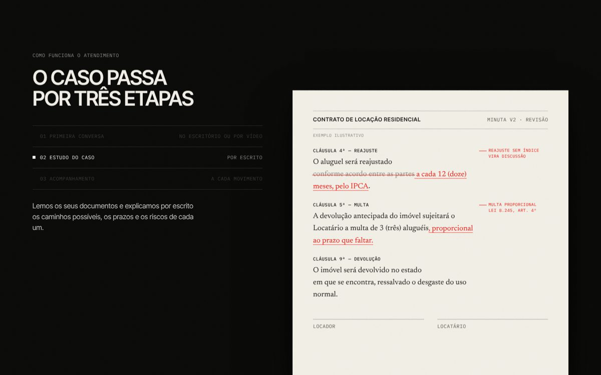
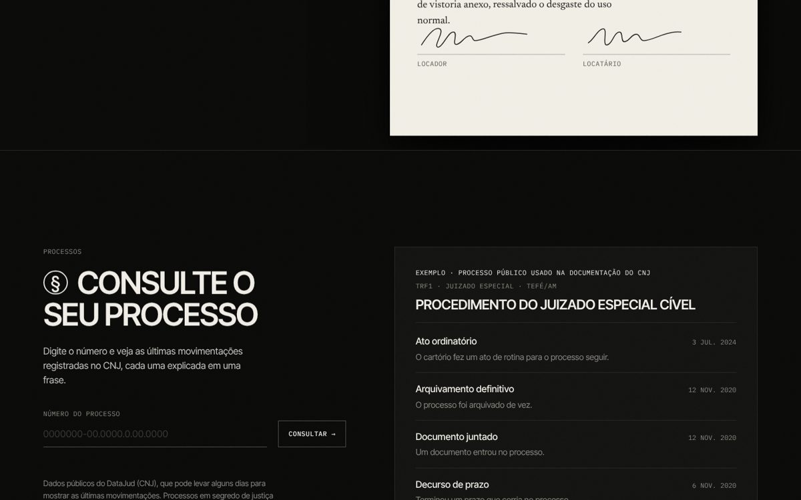

# Modelo de site para escritório de advocacia

Site institucional **revendável** para escritórios de advocacia, com consulta de processos integrada à API pública do CNJ. A demonstração usa um escritório fictício, *Vieira Lacerda Advocacia* (Sorocaba/SP).

**▶ Ver ao vivo:** https://advocacia-modelo-eduardo.netlify.app

| Abertura em vídeo | Núcleos presos à rolagem |
|---|---|
|  |  |
| **Contrato revisado em vermelho** | **Consulta processual** |
|  |  |
| **Áreas de atuação** | **Escritório e equipe** |
|  |  |

## O que tem de diferente

- **Layout Cláusula:** preto e branco com grão de filme animado, títulos em caixa alta (Inter Tight), rótulos em mono (IBM Plex Mono) que embaralham antes de assentar, e uma única cor no site inteiro: o vermelho de revisão, só na folha do contrato.
- **Abertura em vídeo:** a biblioteca jurídica em loop de ida e volta (gerado com IA, em P&B), só no desktop; no celular e com movimento reduzido, a foto parada. Ao rolar, o hero escurece e estreita enquanto os núcleos entram, sem corte seco.
- **Núcleos presos à rolagem:** os três núcleos do escritório (família e civil, trabalho e INSS, consumidor e empresas) trocam na mesma tela, com foto, título por máscara e tabela que embaralha.
- **Como funciona o atendimento:** três etapas ao lado de um contrato de locação de exemplo, revisado em vermelho a cada marco da rolagem até as duas assinaturas se desenharem.
- **Consulta processual com explicação em português:** o visitante digita o número do processo e vê as movimentações registradas no DataJud (CNJ), cada uma "traduzida" em uma frase ("Decurso de prazo" → *Terminou um prazo que corria no processo*).
- **Feito dentro das regras da OAB (Provimento 205/2021):** informativo e sóbrio, sem promessa de resultado, preços, depoimentos ou superlativos; advogados identificados com o número da OAB.
- **Revendável:** nome, áreas, equipe e contatos ficam no `site/index.html`; os campos de exemplo (`OAB/SP nº 000.000`) aparecem marcados para troca.

## Como a consulta processual funciona

A API pública do CNJ leva de 25 s a 1 min por consulta, e às vezes falha. Uma função síncrona do Netlify não espera tanto, então:

1. `GET /api/processo?numero=…` valida o número (dígito verificador CNJ), descobre o tribunal pelo próprio número e procura o resultado no **Netlify Blobs**.
2. Se não houver resultado recente, dispara a função **em segundo plano** `processo-background` (até 15 min), que consulta o DataJud com até 4 tentativas e guarda o resultado.
3. A página pergunta de novo a cada 4 s. Consultas repetidas respondem na hora (resultado guardado por 15 min; erros, só 20 s).

Nada é guardado além do resultado público: a API não traz o nome das partes e processos com sigilo são escondidos.

## Tecnologias

HTML, CSS e JavaScript puro (sem build) · GSAP + ScrollTrigger e Lenis (em `site/vendor/`) · fontes locais (Fontsource) · Netlify Functions (Node.js) · Netlify Blobs · API pública DataJud/CNJ · formulário via FormSubmit

Design: layout *Cláusula* do ProfitizeBuild, adaptado. Fotos, retratos e vídeo do pacote da template, gerados com IA: os retratos são de pessoas que não existem e precisam ser trocados pelas fotos dos advogados reais antes de publicar para um cliente.

## Estrutura

```
site/                     # o que é publicado
├── index.html
├── css/clausula.css      # tokens, seções e responsivo
├── js/main.js            # movimento: grão, scramble, pins, minuta, cursor, nav, barra
├── consulta.js           # consulta processual + "tradução" das movimentações
├── vendor/               # gsap, ScrollTrigger, lenis (versões travadas)
├── fonts/                # Inter Tight, IBM Plex Mono, Newsreader
└── assets/               # fotos P&B (img/) e vídeo do hero (video/)
netlify/
├── functions/processo.mjs             # /api/processo (rápida)
├── functions/processo-background.mjs  # busca lenta no CNJ, em segundo plano
└── lib/datajud.mjs                    # tribunal pelo número, dígito verificador, busca
```

Rodar localmente: `npm install && npx netlify-cli dev`

### Na Vercel

O mesmo repositório também sobe na Vercel (`vercel.json`): publica a pasta `site/` sem build e a consulta roda em `api/processo.mjs`, que usa a mesma biblioteca (`netlify/lib/datajud.mjs`). Lá a função pode durar até 300 s, então a busca acontece na própria requisição; resultados bons ficam 15 min no cache da CDN.

---

Feito por **Eduardo Torres**: crio sites para negócios locais. Quer um assim? [Me chame no LinkedIn](https://www.linkedin.com/in/eduardo-torres-769aa963/).
