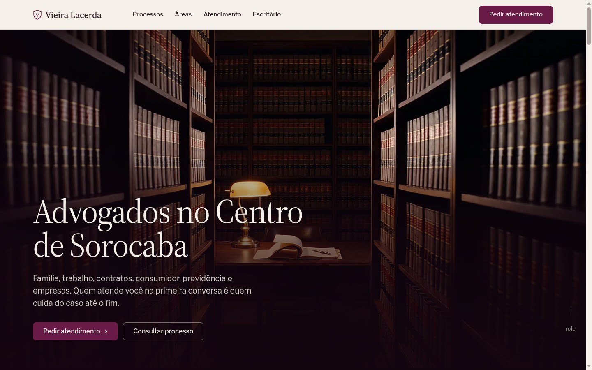
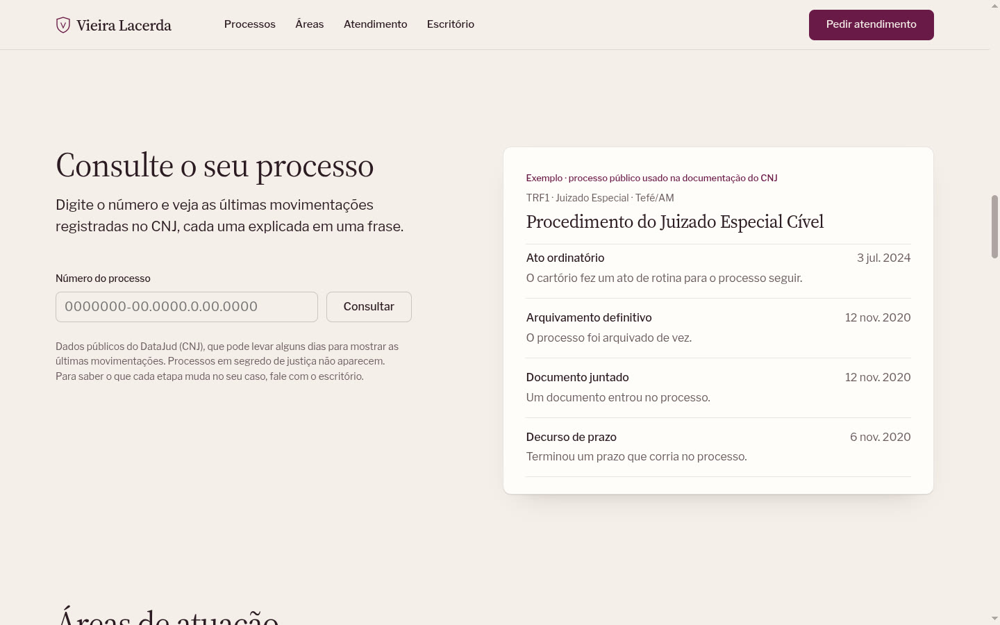
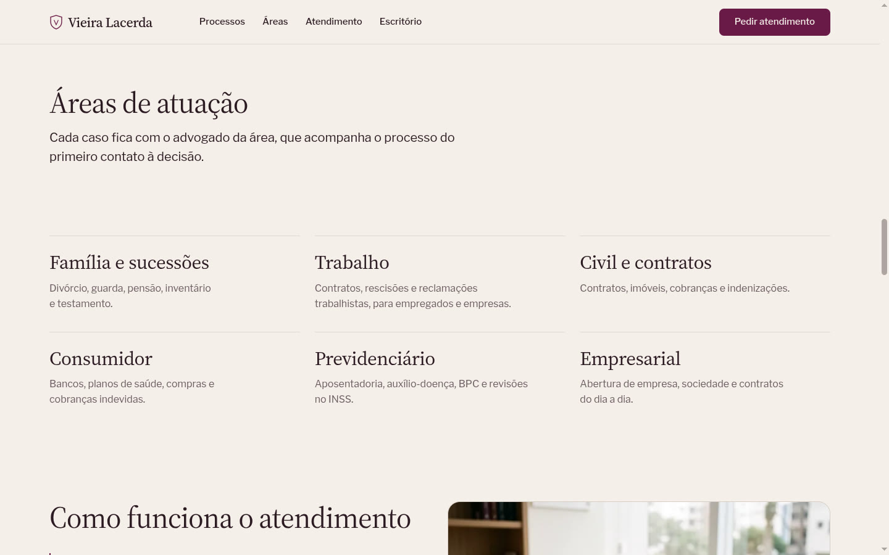

# Modelo de site para escritório de advocacia

Site institucional **revendável** para escritórios de advocacia, com consulta de processos integrada à API pública do CNJ. A demonstração usa um escritório fictício, *Vieira Lacerda Advocacia* (Sorocaba/SP).

**▶ Ver ao vivo:** https://advocacia-modelo-eduardo.netlify.app

| Abertura em vídeo | Consulta processual |
|---|---|
|  |  |
| **Áreas de atuação** | **Escritório e equipe** |
|  |  |

## O que tem de diferente

- **Abertura cinematográfica:** um vídeo de 8 s (gerado com IA) fatiado em 160 quadros e desenhado num `<canvas>` conforme a rolagem. A câmera atravessa uma biblioteca jurídica até a mesa; no fim, a imagem dissolve na cor da página.
- **Consulta processual com explicação em português:** o visitante digita o número do processo e vê as movimentações registradas no DataJud (CNJ), cada uma "traduzida" em uma frase ("Decurso de prazo" → *Terminou um prazo que corria no processo*).
- **Feito dentro das regras da OAB (Provimento 205/2021):** informativo e sóbrio, sem promessa de resultado, preços, depoimentos ou superlativos; advogados identificados com o número da OAB.
- **Revendável:** nome, cores, áreas, equipe e contatos ficam em pontos claros do código; os campos de exemplo (`OAB/SP nº 000.000`) aparecem marcados para troca.

## Como a consulta processual funciona

A API pública do CNJ leva de 25 s a 1 min por consulta, e às vezes falha. Uma função síncrona do Netlify não espera tanto, então:

1. `GET /api/processo?numero=…` valida o número (dígito verificador CNJ), descobre o tribunal pelo próprio número e procura o resultado no **Netlify Blobs**.
2. Se não houver resultado recente, dispara a função **em segundo plano** `processo-background` (até 15 min), que consulta o DataJud com até 4 tentativas e guarda o resultado.
3. A página pergunta de novo a cada 4 s. Consultas repetidas respondem na hora (resultado guardado por 15 min; erros, só 20 s).

Nada é guardado além do resultado público: a API não traz o nome das partes e processos com sigilo são escondidos.

## Tecnologias

HTML, CSS e JavaScript puro (sem build) · Netlify Functions (Node.js) · Netlify Blobs · API pública DataJud/CNJ · formulário via FormSubmit

Design: sistema do [design-taste-frontend](site/assets/LICENSE-design-taste-frontend.txt) (MIT), revisão com *impeccable* e animação seguindo os princípios de Emil Kowalski. Imagens e vídeo gerados com IA.

## Estrutura

```
site/                     # o que é publicado
├── index.html
├── abertura.js           # vídeo na rolagem (canvas)
├── consulta.js           # consulta processual + "tradução" das movimentações
└── assets/               # kit de design, imagens e quadros do vídeo
netlify/
├── functions/processo.mjs             # /api/processo (rápida)
├── functions/processo-background.mjs  # busca lenta no CNJ, em segundo plano
└── lib/datajud.mjs                    # tribunal pelo número, dígito verificador, busca
```

Rodar localmente: `npm install && npx netlify-cli dev`

---

Feito por **Eduardo Torres**: crio sites para negócios locais. Quer um assim? [Me chame no LinkedIn](https://www.linkedin.com/in/eduardo-torres-769aa963/).
